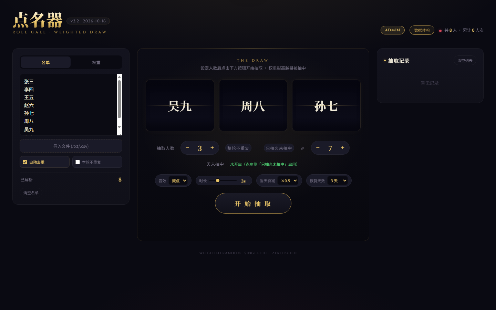

# 点名器 V3・权重抽取舞台

> V2 版本见 https://github.com/Gcy-02/roll-weighted-name-draw

这是课堂点名 / 随机抽取工具的 V3 版本，单文件 HTML，零依赖，下载下来双击就能用。

## 为什么做这个

之前抽同学背面试题，纯随机总觉得不太公平——有人老被抽，有人一直轮不到。所以做了个带权重的点名器：权重越高越容易被抽中，抽中后权重会降下来，过几天再慢慢恢复，让每个人都有机会被点到。

## V3 相比 V2 改了什么

- **只抽久未抽中**：可以只从超过 N 天没被抽中（含从未抽中）的人里抽，阈值 1~30 天可调，默认 7 天
- **恢复天数可配置**：抽中后的权重恢复天数原来写死 3 天，现在可以选 1/2/3/5/7/10 天
- **距上次抽中天数**：权重列表每张卡会显示"距上次 N 天"，谁很久没被抽一眼就能看出来
- **修复"恢复衰减"的显示 bug**：旧版点"恢复衰减"会把所有人的上次抽中日期清掉，导致"被抽过却显示从未抽中"；新版改成"暂停/恢复衰减"开关，不再动数据，缺的日期会自动从抽取记录里补回来
- **修复"只抽久未抽中"失效的 bug**：之前"只抽久未抽中"和"本轮不重复"同时开的时候，久未抽中会失效，昨天刚抽过的人也可能被抽到；现在两个筛选可以叠加，先排除本轮已抽，再只从超过 N 天未抽中的人里抽

## v3.1 更新（2026-10-15）

- **调天数自动开启功能**：以前"只抽久未抽中"的开关和"≥N 天"阈值是两个独立设置，只调天数不开开关的话过滤不生效；现在一调天数就自动开启，旁边也会常显"当前符合 X 人"
- **修复累计次数被覆盖**：多开标签页时旧数据会把新抽的次数顶回去（看着像卡住不涨）；现在保存时自动合并，取更大的累计次数、更新的抽中日期，谁也别想覆盖谁
- **抽取前数据自愈**：上次抽中日期缺失时自动从抽取记录里补回来，不会误判成"从未抽中"而反复被抽
- **数据体检**：右上角多了个"数据体检"按钮，一眼看清开关状态、每人累计几次、上次哪天、是否符合"≥N 天"

## v3.2 更新（2026-10-16）

- **整轮不重复（轮抽模式）**：适合"每天抽几个、抽过的本轮不再抽、全班轮完再来一轮"的场景。开启后抽过的同学自动从本轮池子里排除，抽取区实时显示"本轮已抽 X/Y · 剩余 Z 人"，权重列表里已抽的人划掉变暗；剩余不足抽取人数时当天把剩下的人抽完，全部抽完自动开始新一轮，也可以手动"重置本轮"
- 轮模式下仍按权重抽（权重高的先被点到），但保证每个人一轮内都会轮到一次
- 与"只抽久未抽中 / 本轮不重复"互不冲突，随时切换

## 怎么用

1. 下载 index.html
2. 双击用浏览器打开
3. 把名单粘贴进"名单"面板（换行 / 逗号 / 顿号 / 空格分隔都行），或者直接导入 txt / csv 文件
4. 点"开始抽取"

抽取人数、音效、转盘时长、当天衰减系数都可以在页面上调。

## 适合谁 / 注意事项

- 适合课堂点名、抽人答题、抽人背题、随机分组这类场景
- 名单和数据存在浏览器 localStorage 里（纯本地，不会上传），清浏览器缓存会丢
- 注意名单隐私：页面数据跟着浏览器走，不要拿真实学生名单的页面去分享给别人

## License

MIT
